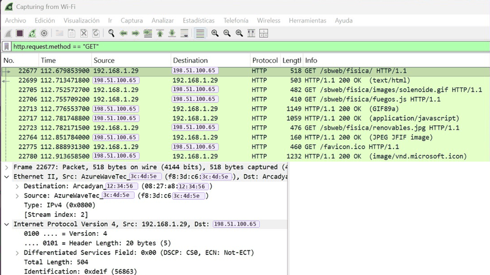
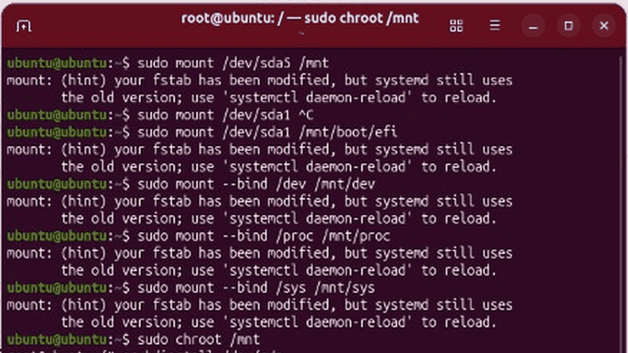
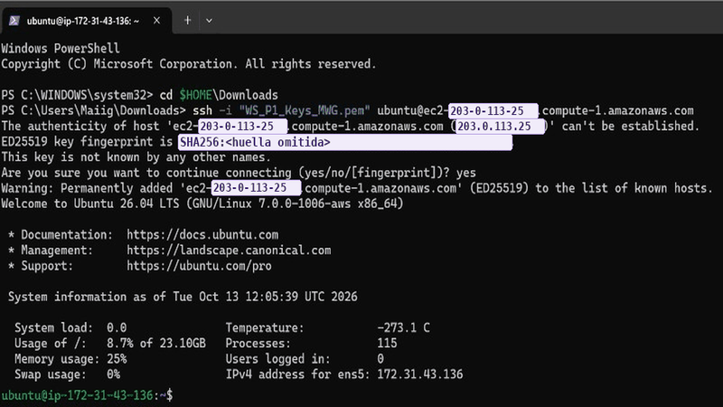
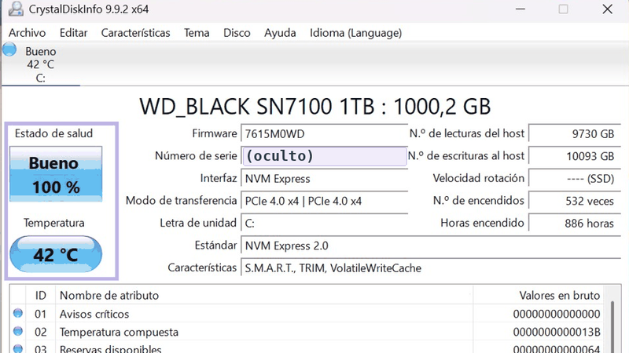

<div align="center">


<a href="https://maite-willinski.github.io"></a>
<a href="https://www.linkedin.com/in/maite-willinski-gonz%C3%A1lez-b05706268/"></a>
<a href="mailto:maitewillinskigonzalez@gmail.com"></a>

</div>

<p align="center">˚ ༘ ♡ ⋆｡˚ ❀ ˚｡⋆ ♡ ༘ ˚</p>

> [!TIP]
> **Busco prácticas duales ♡** · unas 300 horas a partir de **febrero/marzo de 2027** en administración de sistemas, redes o soporte técnico.

## ❀ Sobre este rincón

Aquí vive mi portafolio web y la documentación de las prácticas que hago en clase. Cada proyecto tiene su
propio README paso a paso, con capturas reales, los problemas que me encontré y cómo los resolví.

<p align="center">˚ ༘ ♡ ⋆｡˚ ❀ ˚｡⋆ ♡ ༘ ˚</p>

## ✿ Proyectos

<table>
<tr>
<td width="50%" valign="top" align="center">
<a href="proyectos/redes-wireshark"></a>

<h3><a href="proyectos/redes-wireshark">❀ Redes y Wireshark</a></h3>
<p>Subnetting, cuellos de botella y análisis capa a capa de capturas reales de ARP, DNS y HTTP.</p>
<p><sub>Wireshark ⋆ Subnetting ⋆ Packet Tracer</sub></p>
</td>
<td width="50%" valign="top" align="center">
<a href="proyectos/arranque-dual-grub"></a>

<h3><a href="proyectos/arranque-dual-grub">❀ Arranque dual y GRUB</a></h3>
<p>Windows 11 + Ubuntu con UEFI. Rompí el arranque a propósito y lo recuperé desde la terminal.</p>
<p><sub>VirtualBox ⋆ UEFI ⋆ GRUB</sub></p>
</td>
</tr>
<tr>
<td width="50%" valign="top" align="center">
<a href="proyectos/servidores-web-aws"></a>

<h3><a href="proyectos/servidores-web-aws">❀ Servidores web en AWS</a></h3>
<p>Ubuntu con nginx y Windows Server con IIS en EC2, con acceso por SSH y RDP.</p>
<p><sub>AWS EC2 ⋆ SSH ⋆ nginx ⋆ IIS</sub></p>
</td>
<td width="50%" valign="top" align="center">
<a href="proyectos/diagnostico-hardware"></a>

<h3><a href="proyectos/diagnostico-hardware">❀ Diagnóstico de hardware</a></h3>
<p>UEFI, salud del SSD con S.M.A.R.T., test de RAM y averías de arranque.</p>
<p><sub>CrystalDiskInfo ⋆ MemTest64</sub></p>
</td>
</tr>
</table>

<p align="center">˚ ༘ ♡ ⋆｡˚ ❀ ˚｡⋆ ♡ ༘ ˚</p>

## ✦ Con qué trabajo

<p align="center">
  
</p>

<p align="center">


</p>

<p align="center">˚ ༘ ♡ ⋆｡˚ ❀ ˚｡⋆ ♡ ༘ ˚</p>

## ❁ Sobre la web

- Hecha a mano con **HTML y CSS**, sin frameworks ni JavaScript.
- Pensada para el **móvil**, porque los reclutadores suelen abrir los enlaces desde el teléfono.
- **Accesible:** se puede navegar con el teclado, el contraste está comprobado (WCAG AA) y respeta la opción de "reducir movimiento".
- Paleta lavanda, violeta y rosa empolvado, a juego con mi CV.

<details>
<summary><b>♡ Ver la estructura del repositorio</b></summary>

```
├── index.html          Página principal
├── css/style.css       Estilos
├── img/                Foto de la web
├── assets/             CV en PDF
└── proyectos/
    └── <proyecto>/
        ├── README.md   Documentación de la práctica
        └── img/        Capturas
```
</details>

> [!NOTE]
> **Privacidad ♡** En las capturas, las IP públicas, las direcciones MAC y otros datos identificativos se han
> sustituido por valores de ejemplo (rangos de documentación como `198.51.100.0/24` y `203.0.113.0/24`) y aparecen marcados en lavanda.

<div align="center">

<br>
<sub>Hecho con ♡ por Maite Willinski · Écija (Sevilla)</sub>


</div>
