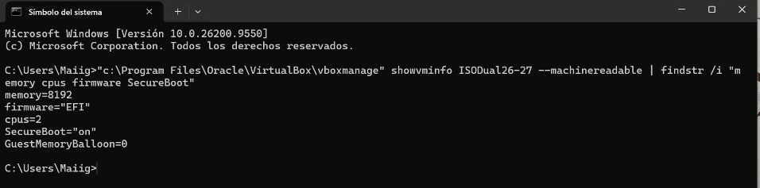
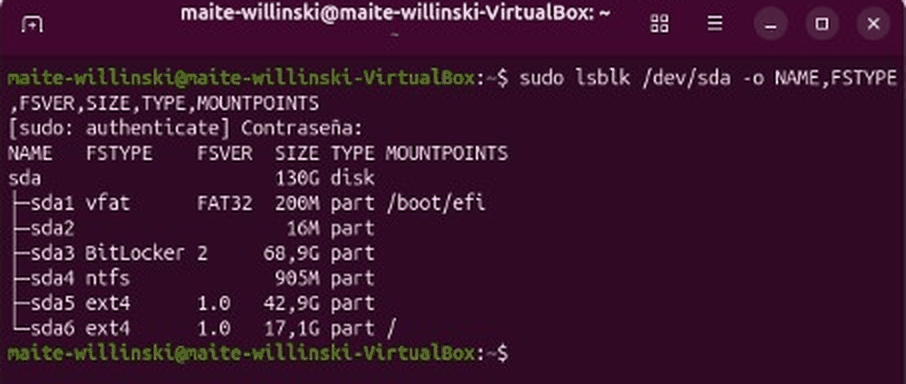
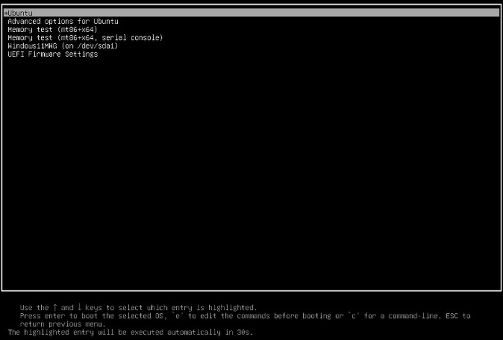
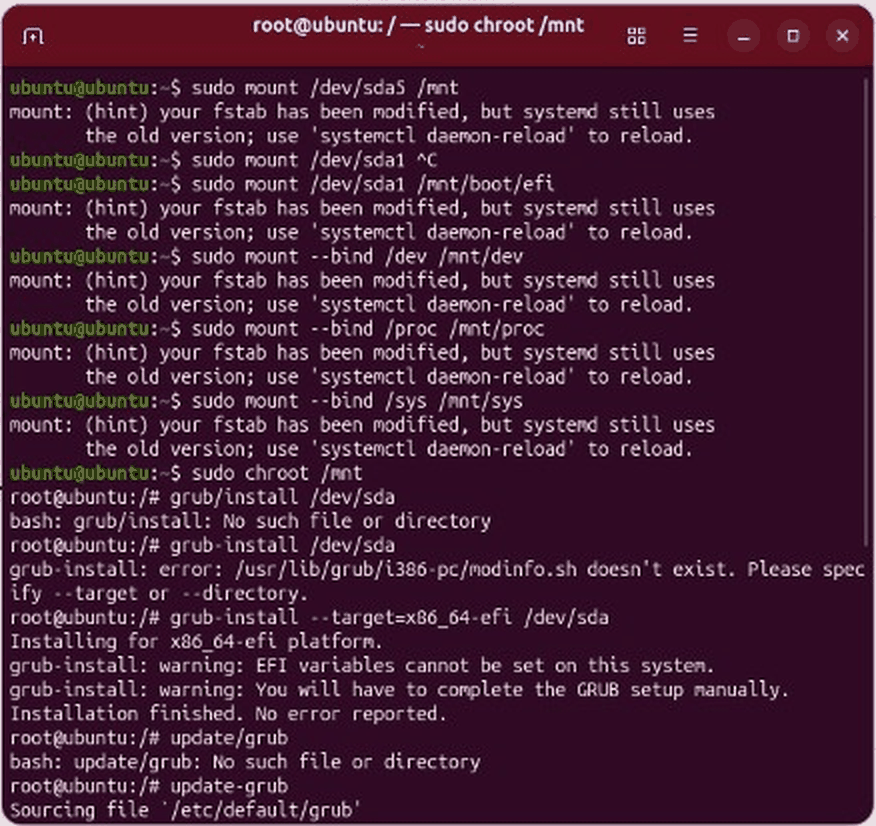

<a href="https://maite-willinski.github.io">♡ Volver al portafolio</a> &nbsp;·&nbsp; <a href="https://github.com/Maite-Willinski/Maite-Willinski.github.io">❀ Ver todos los proyectos</a>

 

<table align="center"><tr><td align="center">
 
<i>Instalé Windows 11 y Ubuntu en la misma máquina, borré a propósito la partición EFI y recuperé el arranque de los dos sistemas desde la línea de comandos.</i>
  
</td></tr></table>

˚ ༘ ♡ ⋆｡˚ ❀ ˚｡⋆ ♡ ༘ ˚

## ❀ Objetivo
Instalar Windows 11 y Ubuntu en la misma máquina virtual con UEFI y Secure Boot, personalizar el gestor
de arranque GRUB y, después, provocar a propósito un fallo de arranque borrando la partición EFI para
recuperar los dos sistemas solo con la línea de comandos.

˚ ༘ ♡ ⋆｡˚ ❀ ˚｡⋆ ♡ ༘ ˚

## ✿ Qué he hecho

### ✿ Paso 1 · Máquina virtual con UEFI y Secure Boot
Creé la VM en VirtualBox con 8 GB de RAM, 2 CPU, firmware EFI y Secure Boot activado, y lo comprobé con
`VBoxManage`.

  
   ⋆ Configuración de la VM con VBoxManage ⋆

### ✿ Paso 2 · Instalación de los dos sistemas y particionado
Instalé primero Windows 11 y después Ubuntu en el mismo disco. Con `lsblk` se ve el resultado: la
partición **EFI** (FAT32, montada en `/boot/efi`), las particiones de Windows (NTFS / BitLocker) y las de
Ubuntu (ext4).

  
   ⋆ Particiones del disco con lsblk ⋆

También instalé las **Guest Additions** en los dos sistemas. En Ubuntu tuve que instalar antes las
dependencias (`gcc`, `make`, `perl`…) y registrar la clave con **MOK Management** al reiniciar, porque
Secure Boot no deja cargar módulos del kernel sin firmar.

### ✿ Paso 3 · Personalización de GRUB
Edité `/etc/default/grub` y la entrada de Windows en `grub.cfg` para que aparezca con mis iniciales.

  
   ⋆ Menú de GRUB con la entrada de Windows personalizada ⋆

### ✿ Paso 4 · Simulación de avería y recuperación
Desmonté y formateé la partición EFI (`umount /boot/efi` y `mkfs.fat -F32 /dev/sda1`), así que ninguno de
los dos sistemas podía arrancar. Después:

- **Windows:** arranqué desde el disco de instalación, abrí la consola y regeneré los archivos de arranque
  con `bcdboot`.
- **Ubuntu:** arranqué en modo live, monté el sistema instalado en `/mnt` (también `/boot/efi`, `/dev`,
  `/proc` y `/sys`), entré con `chroot`, reinstalé GRUB y regeneré su configuración.
- Por último cambié el orden de arranque en la UEFI para que GRUB volviera a ser el primero.

  
   ⋆ Recuperación de GRUB con chroot y grub-install ⋆

˚ ༘ ♡ ⋆｡˚ ❀ ˚｡⋆ ♡ ༘ ˚

## ♡ Problemas y cómo los resolví
- **`grub-install /dev/sda` daba error** (`/usr/lib/grub/i386-pc/modinfo.sh doesn't exist`): sin indicar
  nada, intentaba instalar la versión para BIOS clásica (i386-pc). Me di cuenta de que el sistema arranca
  en **UEFI** y lo arreglé indicando la plataforma: `grub-install --target=x86_64-efi /dev/sda`, y después
  `update-grub`.
- **El teclado estaba en inglés** en el entorno live y escribía `/` en lugar de `-` (se ve en
  `grub/install` en la captura). Lo detecté por el error "No such file or directory" y corregí los comandos.

˚ ༘ ♡ ⋆｡˚ ❀ ˚｡⋆ ♡ ༘ ˚

## ✦ Tecnologías

˚ ༘ ♡ ⋆｡˚ ❀ ˚｡⋆ ♡ ༘ ˚

## ❁ Qué he aprendido
- Cómo arranca un equipo UEFI: firmware → partición EFI → gestor de arranque → sistema operativo.
- A recuperar un sistema que no arranca sin herramientas automáticas como Boot Repair.
- A leer los mensajes de error para saber qué está fallando de verdad (BIOS frente a UEFI).

˚ ༘ ♡ ⋆｡˚ ❀ ˚｡⋆ ♡ ༘ ˚

Hecho con ♡ por Maite Willinski · Técnica SMR y estudiante de ASIR

