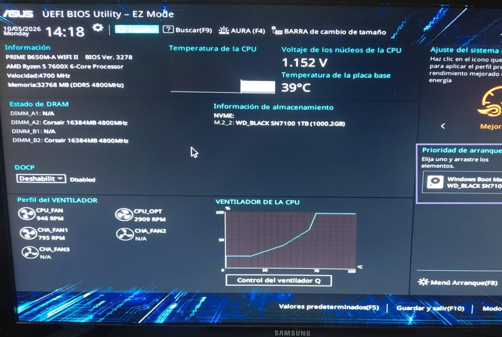
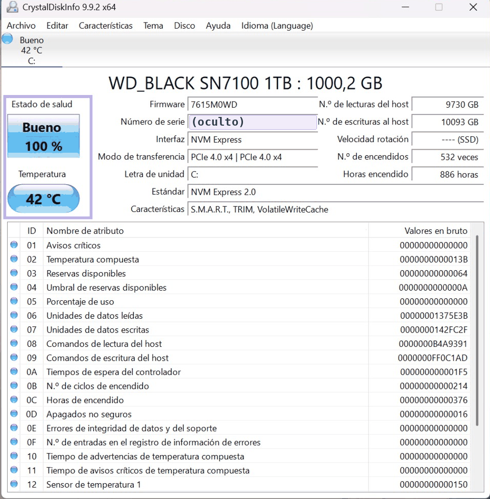
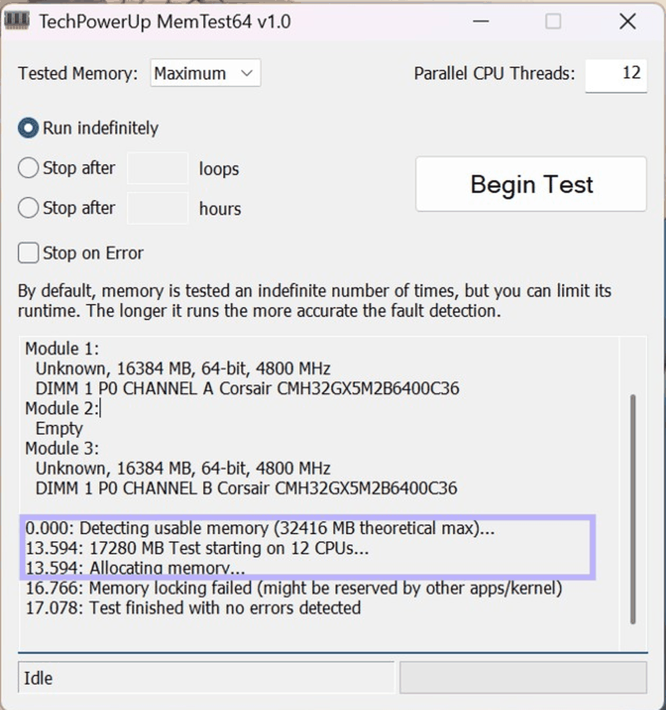

# Diagnóstico de hardware: UEFI, disco SSD y memoria RAM

Módulo: Fundamentos de Hardware (ASIR) · Fecha: octubre de 2026

> En la captura de CrystalDiskInfo se ha ocultado el número de serie del disco.

## Objetivo
Revisar el estado de un equipo real (el mío) con las herramientas que se usan en soporte técnico:
configuración en la UEFI, salud del disco, test de memoria y rendimiento de la CPU. También diagnosticar
averías típicas de arranque.

## Qué he hecho

### 1. Información desde la UEFI
Comprobé la memoria instalada (32 GB DDR5 a 4800 MHz en dos módulos de 16 GB, en las ranuras A2 y B2 para
trabajar en **Dual Channel**) y el orden de arranque, con Windows Boot Manager en el SSD NVMe.

### 2. Salud del disco con CrystalDiskInfo
Analicé los valores **S.M.A.R.T.** del SSD: estado "Bueno" al 100 %, 42 °C, interfaz **PCIe 4.0 x4** con NVMe
2.0, horas de uso y datos escritos (desgaste muy bajo) y **TRIM** activo, que ayuda a que el SSD mantenga
su rendimiento con el tiempo.

### 3. Test de memoria RAM
Pasé TechPowerUp MemTest64 en modo máximo con 12 hilos. Detectó los dos módulos en canales distintos y la
prueba terminó **sin errores**.

### 4. Rendimiento de la CPU
Con Cinebench medí la CPU en un núcleo y en todos los hilos (Ryzen 5 7600X, 6 núcleos y 12 hilos). La
relación entre los dos resultados (7,29×) indica lo bien que escala el procesador en tareas en paralelo,
como la virtualización.

### 5. Diagnóstico de averías de arranque
- **No pita y no responde:** lo más probable es la fuente de alimentación (no envía la señal *Power Good*) o
  una avería grave en la placa base. Ojo: muchos equipos modernos no traen el altavoz interno, así que
  "no pita" no siempre significa que el POST haya fallado. **Me pasó en mis prácticas de SMR.**
- **Pitidos cortos continuos:** problema de alimentación de la placa base, conector ATX de 24 pines mal
  conectado o, según la BIOS, memoria RAM mal insertada o dañada.

## Problemas y cómo los resolví
- **Aviso "Memory locking failed" en el test de RAM:** al principio parece un error, pero no lo es. El
  test se ejecuta dentro de Windows y el sistema tiene reservada parte de la memoria, así que el programa
  solo pudo probar 17 GB de los 32 GB. El resultado es fiable para esa parte, y la prueba terminó sin errores.

## Tecnologías
UEFI · CrystalDiskInfo (S.M.A.R.T.) · MemTest64 · Cinebench · NVMe · DDR5

## Qué he aprendido
- A comprobar el estado de un disco y de la memoria antes de dar un equipo por bueno.
- A interpretar Dual Channel, TRIM y los datos S.M.A.R.T.
- A plantear un diagnóstico de arranque por pasos, de lo más probable a lo menos probable.
