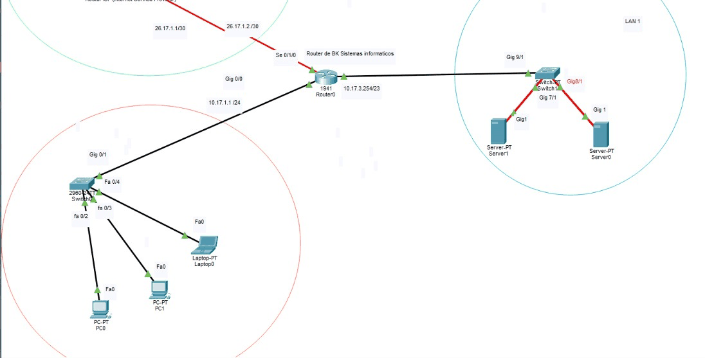
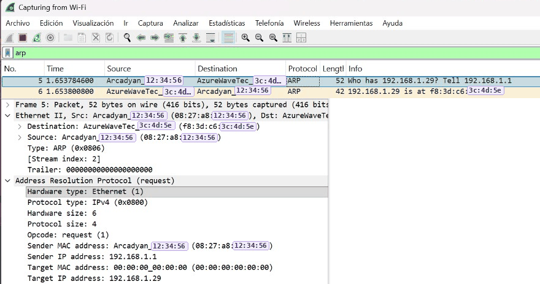
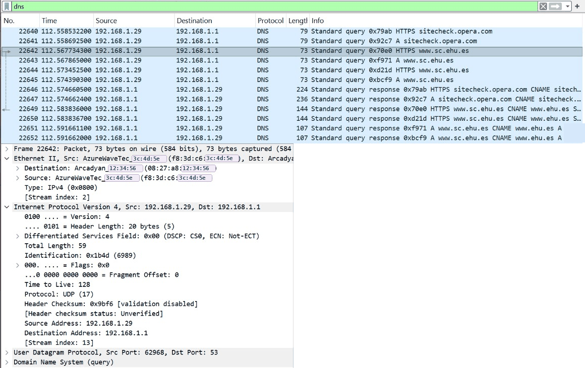
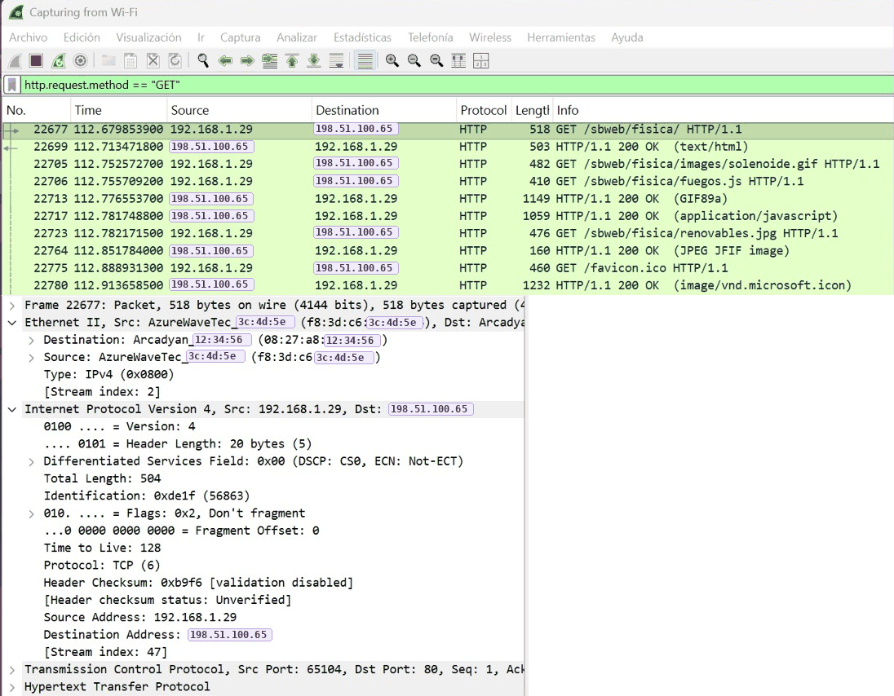
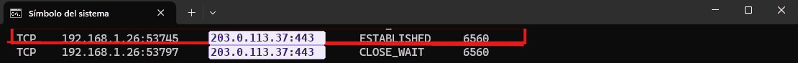
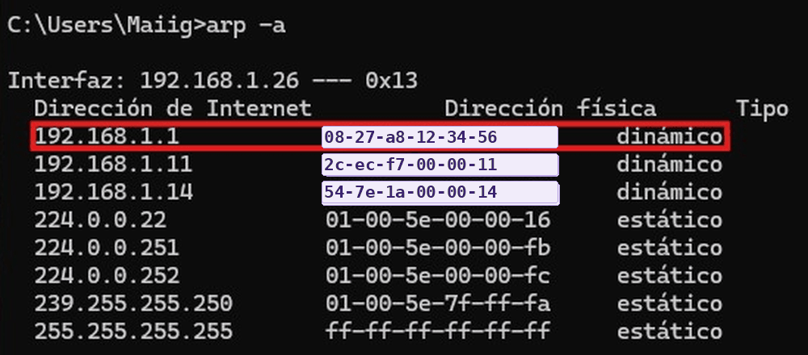

<a href="https://maite-willinski.github.io">🌸 Volver al portafolio</a> · <a href="https://github.com/Maite-Willinski/Maite-Willinski.github.io">📂 Todos los proyectos</a>

 

> **En una frase:** calculé subredes y cuellos de botella de una red con dos LAN y comprobé con capturas reales cómo viajan ARP, DNS y HTTP por las capas TCP/IP.

> [!NOTE]
> 🔒 Las IP públicas y las direcciones MAC de las capturas se han sustituido por valores de ejemplo (rangos reservados para documentación, como 198.51.100.0/24 y 203.0.113.0/24). Aparecen marcados en lavanda.

## 🎯 Objetivo
Analizar una red con dos LAN y salida a Internet: distinguir la parte pública de la privada, calcular
subredes y el ancho de banda real, y comprobar con capturas reales cómo viaja un paquete por las capas
TCP/IP (ARP, DNS y HTTP).

## 🛠️ Qué he hecho

### 01 · Análisis de una topología (Packet Tracer)

  
   <i>Topología con dos LAN y enlace al ISP</i>

- Separé la **parte privada (LAN)**, con los dos switches, los PC y los servidores, de la **parte pública (WAN)**:
  router del ISP, nube de Internet y enlace serie.
- Clasifiqué cada IP por tipo (pública o privada) y clase, y calculé su dirección de red y de difusión:

| Enlace | Máscara | Red | Difusión |
| --- | --- | --- | --- |
| WAN (router – ISP) | /30 · 255.255.255.252 | 26.17.1.0 | 26.17.1.3 |
| LAN 2 (PC) | /24 · 255.255.255.0 | 10.17.1.0 | 10.17.1.255 |
| LAN 1 (servidores) | /23 · 255.255.254.0 | 10.17.2.0 | 10.17.3.255 |

- Calculé tiempos de descarga buscando el **cuello de botella**: un fichero de 500 MB son 4000 Mb; con una
  tarjeta GigabitEthernet (1000 Mbps) tarda 4 s, y con FastEthernet (100 Mbps), 40 s.
- Con salida a Internet de 500 Mbps y equipos FastEthernet, pueden descargar a la vez a máxima velocidad
  500 / 100 = **5 equipos**.

### 02 · Subnetting (VLSM básico)
Partiendo de un rango /25 de ejemplo (172.16.50.0/25), calculé la máscara para 30 equipos por subred:
2⁵ − 2 = 30 → 5 bits de host → **/27 (255.255.255.224)**, con 2 bits prestados → **4 subredes**.

| Subred | Red | Hosts | Difusión |
| --- | --- | --- | --- |
| 1 | 172.16.50.0/27 | .1 – .30 | .31 |
| 2 | 172.16.50.32/27 | .33 – .62 | .63 |
| 3 | 172.16.50.64/27 | .65 – .94 | .95 |
| 4 | 172.16.50.96/27 | .97 – .126 | .127 |

### 03 · Capturas reales con Wireshark (ARP, DNS y HTTP)
Antes de capturar vacié la caché ARP (`arp -d *`) y la DNS (`ipconfig /flushdns`) para obligar al
equipo a generar todo el tráfico desde cero. Después abrí una web HTTP y filtré por protocolo.

**ARP:** el router (192.168.1.1) pregunta qué MAC tiene la IP de mi PC (192.168.1.29). ARP no usa puertos:
trabaja entre la capa de enlace y la de red.

  
   <i>Captura ARP en Wireshark</i>

**DNS:** mi PC envía la consulta por **UDP** desde un puerto aleatorio (62968) al **puerto 53** del router,
que hace de servidor DNS, para traducir el nombre de la web a una IP.

  
   <i>Captura DNS en Wireshark</i>

**HTTP:** el navegador abre una conexión **TCP** desde un puerto efímero (65104) al **puerto 80** del
servidor y envía un `GET`. La IP de destino es la del servidor web, pero la **MAC de destino es la de mi
router**, porque las MAC solo sirven dentro de la red local y cambian en cada salto.

  
   <i>Captura HTTP en Wireshark</i>

### 04 · Comprobación con comandos (HTTPS)
Identifiqué los datos de una respuesta HTTPS que llega a mi PC con `netstat -ano`, `ping` y `arp -a`:
puertos (443 en el servidor y un puerto efímero en mi equipo), IP de origen y MAC del router.

  
   <i>netstat filtrando el puerto 443</i>

  
   <i>Tabla ARP con la MAC del router</i>

## 🧩 Problemas y cómo los resolví
- **Vaciado de cachés:** si las cachés ARP y DNS tienen datos, el equipo no genera las peticiones iniciales
  y no aparecen en la captura. Tuve que vaciarlas con los comandos adecuados antes de capturar y, como hay
  muchísimo tráfico, usar filtros para encontrar los paquetes (`arp`, `dns`, `http.request.method == "GET"`).
- **La MAC de origen no era la del servidor:** entendí que en un paquete que viene de Internet la MAC de
  origen es la del último salto (mi router), no la del servidor, mientras que las IP de origen y destino
  se mantienen (salvo el cambio que hace el NAT en el router).

## 🧰 Tecnologías

## 🌱 Qué he aprendido
- A leer una captura capa a capa: MAC (enlace), IP (red) y puertos (transporte).
- A calcular subredes y a localizar el cuello de botella real de una red.
- La diferencia entre puertos conocidos (53, 80, 443) y puertos efímeros del cliente.

 

Hecho con 💜 por Maite Willinski · Técnica SMR y estudiante de ASIR

