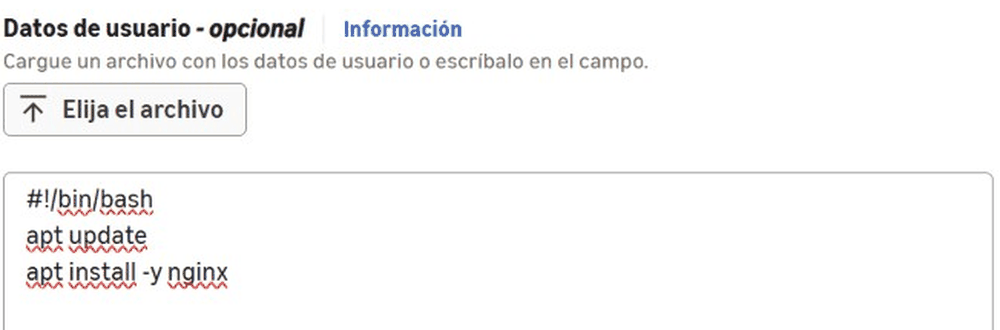
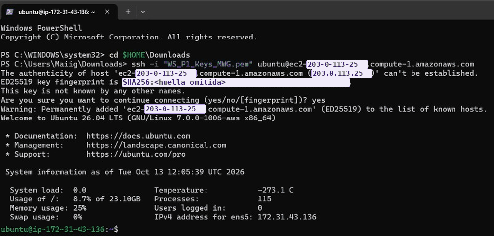
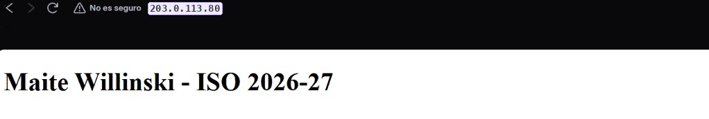
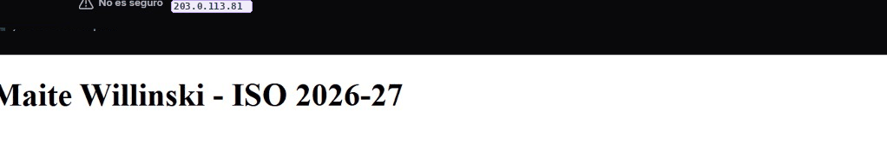

# Servidores web en AWS EC2: Ubuntu con nginx y Windows Server con IIS

Módulo: Implantación de Sistemas Operativos (ASIR) · Plataforma: AWS Academy · Fecha: octubre – noviembre de 2026

> Las IP públicas de las instancias y la huella de la clave SSH se han sustituido por valores de ejemplo.
> Las instancias de AWS Academy son temporales y ya no existen.

## Objetivo
Crear dos máquinas virtuales en la nube con Amazon EC2, una con Ubuntu Server y otra con Windows Server,
conectarme a ellas de forma remota y publicar en cada una una página web propia.

## Qué he hecho

### 1. Crear las instancias
Lancé las dos instancias desde EC2 con su **par de claves** y su **grupo de seguridad** (el firewall de
AWS). En la de Ubuntu añadí un script en **datos de usuario**, que se ejecuta solo al arrancar la máquina
por primera vez y deja nginx instalado:

### 2. Acceso remoto
- **Ubuntu:** por **SSH** con la clave privada `.pem` (sin contraseña), abriendo el puerto 22 en el grupo de seguridad.
- **Windows Server:** por **Escritorio remoto (RDP)**.

### 3. Servidor web en Ubuntu (nginx)
Comprobé que nginx estaba en marcha, abrí el puerto **80 (HTTP)** en el grupo de seguridad y modifiqué la
página de inicio en `/var/www/html`.

### 4. Servidor web en Windows Server (IIS)
Instalé el rol **Internet Information Services (IIS)**, abrí el puerto 80 y creé mi propio `index.html` en
`C:\inetpub\wwwroot`, que sustituye a la página de bienvenida sin borrar `iisstart.htm` (IIS da prioridad
a `index.html`).

## Problemas y cómo los resolví
- **Puertos cerrados por defecto:** AWS bloquea todo el tráfico de entrada que no se haya permitido en el
  grupo de seguridad, así que para ver las webs hubo que abrir expresamente el puerto 80 (HTTP) en las dos
  instancias.
- **Aviso de "host desconocido" al conectar por SSH la primera vez:** es normal. El cliente guarda la
  huella del servidor en `known_hosts` para avisar si cambia en futuras conexiones (podría ser un ataque
  de intermediario).

## Tecnologías
AWS EC2 · Ubuntu Server · Windows Server · nginx · IIS · SSH con claves · RDP · Grupos de seguridad

## Qué he aprendido
- A desplegar y administrar servidores en la nube y a controlar el acceso con grupos de seguridad.
- La diferencia entre autenticarse por SSH con clave y por contraseña.
- A montar un servidor web básico tanto en Linux como en Windows.
